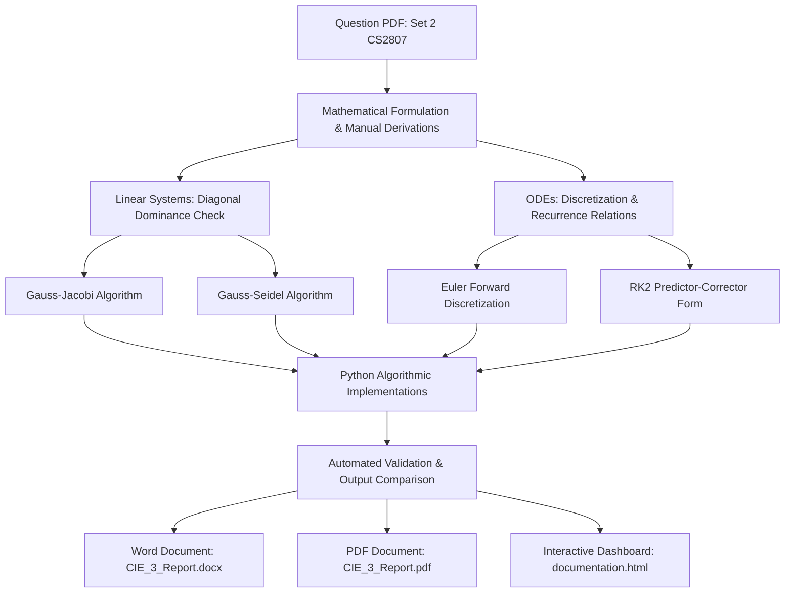

# CS2807: Numerical Methods – Python Coding Activity (CIE-3)

[](mailto:)
[]()
[]()
[]()
[](https://rvu.edu.in)

> **Continuous Internal Evaluation 3 (CIE-3)**  
> **School of Computer Science and Engineering, RV University**  
> **Course:** CS2807 Numerical Methods | Semester III BCA (Hons)  
> **Activity:** Set 2 – Iterative Linear Solvers and Initial Value Problems (IVPs)

---

## 📌 Table of Contents
1. [Project Overview & Objectives](#-project-overview--objectives)
2. [Workflow & Architecture](#-workflow--architecture)
3. [Summary of Results](#-summary-of-results)
4. [Detailed Problem Analysis & Verifications](#-detailed-problem-analysis--verifications)
   - [Problem 1: Gauss–Jacobi Iterative Method](#problem-1-gaussjacobi-iterative-method)
   - [Problem 2: Gauss–Seidel Iterative Method](#problem-2-gaussseidel-iterative-method)
   - [Problem 3: Euler’s Method for ODEs](#problem-3-eulers-method-for-odes)
   - [Problem 4: Newton's Law of Cooling (Euler Application)](#problem-4-newtons-law-of-cooling-euler-application)
   - [Problem 5: Runge–Kutta 2nd Order Method (RK2)](#problem-5-rungekutta-2nd-order-method-rk2)
   - [Problem 6: Salt Mixture Problem (RK2 Application)](#problem-6-salt-mixture-problem-rk2-application)
5. [Project Structure & File Guide](#-project-structure--file-guide)
6. [Interactive Documentation & Visualizations](#-interactive-documentation--visualizations)
7. [How to Run the Code](#-how-to-run-the-code)

---

## 🚀 Project Overview & Objectives

This project implements, mathematically verifies, and computationally validates fundamental numerical algorithms across two key domains in computational mathematics:

1. **Iterative Solvers for Systems of Linear Algebraic Equations ($A\mathbf{x} = \mathbf{b}$):**
   - **Gauss–Jacobi Iteration:** Simultaneous component updating.
   - **Gauss–Seidel Iteration:** Successive component updating leveraging in-situ values for faster convergence.
   - Verification of the **Strict Diagonal Dominance** criterion: $|a_{ii}| > \sum_{j \neq i} |a_{ij}|$.

2. **Numerical Solutions for Initial Value Problems (IVPs, $\frac{dy}{dt} = f(t, y)$):**
   - **Euler's Forward Method:** First-order truncation error $\mathcal{O}(h)$, applied to polynomial non-linear ODEs and thermodynamic transient cooling.
   - **Runge–Kutta 2nd Order Method (Heun's Predictor-Corrector):** Second-order accuracy $\mathcal{O}(h^2)$, solving non-linear trigonometric ODEs and transient mass-balance dynamical systems in fluid mixing.

---

## 🏗 Workflow & Architecture



---

## 📊 Summary of Results

| Problem | Mathematical Method | Input Parameters / System | Target Quantity | Manual Solution | Python Computed | Error / Convergence |
| :--- | :--- | :--- | :--- | :--- | :--- | :--- |
| **1** | Gauss–Jacobi Iteration | $9x - y + 2z = 18$<br>$2x + 8y - z = -5$<br>$x - 2y + 10z = 21$ | $(x, y, z)$ | $x = 1.5150$<br>$y = -0.7797$<br>$z = 1.7926$ | $x = 1.5150$<br>$y = -0.7797$<br>$z = 1.7926$ | Converged in **8 iterations** ($\text{tol} = 10^{-4}$) |
| **2** | Gauss–Seidel Iteration | $5x + y - z = 10$<br>$-x + 6y + 2z = -2$<br>$2x - y + 7z = 9$ | $(x, y, z)$ | $x = 2.1653$<br>$y = -0.1860$<br>$z = 0.6405$ | $x = 2.1653$<br>$y = -0.1860$<br>$z = 0.6405$ | Converged in **6 iterations** ($\text{tol} = 10^{-4}$) |
| **3** | Euler's Method | $\frac{dy}{dx} = x + y^2$, $y(0) = 1$ | $y(0.1), y(0.2), y(0.3)$ with $h = 0.1$ | $y(0.1) = 1.1000$<br>$y(0.2) = 1.2310$<br>$y(0.3) = 1.4025$ | $y(0.1) = 1.1000$<br>$y(0.2) = 1.2310$<br>$y(0.3) = 1.4025$ | Step-by-step exact match |
| **4** | Newton's Law of Cooling | $\frac{dT}{dt} = -0.05(T - 20)$, $T(0) = 90^\circ\text{C}$ | $T(8)$ with $h = 4\text{ min}$ | $T(4) = 76.00^\circ\text{C}$<br>$T(8) = 64.80^\circ\text{C}$ | $T(4) = 76.00^\circ\text{C}$<br>$T(8) = 64.80^\circ\text{C}$ | Exact linear decay match |
| **5** | Runge–Kutta 2nd Order | $\frac{dy}{dx} = \sin(x - y)$, $y(0) = 1$ | $y(0.3)$ with $h = 0.1$ | $y(0.1) = 0.9215$<br>$y(0.2) = 0.8547$<br>$y(0.3) = 0.8006$ | $y(0.1) = 0.9215$<br>$y(0.2) = 0.8547$<br>$y(0.3) = 0.8006$ | $\mathcal{O}(h^2)$ accurate |
| **6** | RK2 Salt Mixture | $\frac{dy}{dt} = 12 - \frac{y}{20}$, $y(0) = 0$ | $y(15)$ with $h = 5\text{ min}$ | $y(15) = 125.5591\text{ g}$ | $y(15) = 125.5591\text{ g}$ | Analytical: $126.6320\text{ g}$ (Error: $0.85\%$) |

---

## 🔍 Detailed Problem Analysis & Verifications

### Problem 1: Gauss–Jacobi Iterative Method
- **Matrix Formulation:** $A = \begin{bmatrix} 9 & -1 & 2 \\ 2 & 8 & -1 \\ 1 & -2 & 10 \end{bmatrix},\quad \mathbf{b} = \begin{bmatrix} 18 \\ -5 \\ 21 \end{bmatrix}$
- **Convergence Condition:** The matrix is strictly diagonally dominant:
  $$|9| > |-1| + |2| = 3,\quad |8| > |2| + |-1| = 3,\quad |10| > |1| + |-2| = 3$$
- **Iteration Equations:**
  $$x^{(k+1)} = \frac{18 + y^{(k)} - 2z^{(k)}}{9},\quad y^{(k+1)} = \frac{-5 - 2x^{(k)} + z^{(k)}}{8},\quad z^{(k+1)} = \frac{21 - x^{(k)} + 2y^{(k)}}{10}$$
- **Python Source:** [`problem_1_gauss_jacobi.py`](file:///D:/Mathematics/problem_1_gauss_jacobi.py)

---

### Problem 2: Gauss–Seidel Iterative Method
- **Matrix Formulation:** $A = \begin{bmatrix} 5 & 1 & -1 \\ -1 & 6 & 2 \\ 2 & -1 & 7 \end{bmatrix},\quad \mathbf{b} = \begin{bmatrix} 10 \\ -2 \\ 9 \end{bmatrix}$
- **Advantage over Jacobi:** Immediately uses updated values $x^{(k+1)}$ in calculating $y^{(k+1)}$ and both in $z^{(k+1)}$, reducing iterations from 8 down to 6.
- **Iteration Equations:**
  $$x^{(k+1)} = \frac{10 - y^{(k)} + z^{(k)}}{5},\quad y^{(k+1)} = \frac{-2 + x^{(k+1)} - 2z^{(k)}}{6},\quad z^{(k+1)} = \frac{9 - 2x^{(k+1)} + y^{(k+1)}}{7}$$
- **Python Source:** [`problem_2_gauss_seidel.py`](file:///D:/Mathematics/problem_2_gauss_seidel.py)

---

### Problem 3: Euler’s Method for ODEs
- **IVP Formulation:** $\frac{dy}{dx} = x + y^2,\quad y(0) = 1,\quad h = 0.1$
- **Recurrence:** $y_{n+1} = y_n + h(x_n + y_n^2)$
- **Trajectory:**
  - $n = 0: x_0 = 0.0, y_0 = 1.0000 \implies y_1 = 1.0 + 0.1(1.0) = 1.1000$
  - $n = 1: x_1 = 0.1, y_1 = 1.1000 \implies y_2 = 1.1 + 0.1(1.31) = 1.2310$
  - $n = 2: x_2 = 0.2, y_2 = 1.2310 \implies y_3 = 1.231 + 0.1(1.715361) = 1.4025$
- **Python Source:** [`problem_3_euler_method.py`](file:///D:/Mathematics/problem_3_euler_method.py)

---

### Problem 4: Newton's Law of Cooling (Euler Application)
- **Thermodynamic Model:** $\frac{dT}{dt} = -k(T - T_a) = -0.05(T - 20)$
- **Parameters:** Initial hot temperature $T(0) = 90^\circ\text{C}$, ambient $T_a = 20^\circ\text{C}$, time step $h = 4\text{ min}$.
- **Step 1 ($t = 0 \to 4\text{ min}$):** $\frac{dT}{dt}\big|_0 = -0.05(70) = -3.5^\circ\text{C/min} \implies T(4) = 90 - 4(3.5) = 76.0^\circ\text{C}$
- **Step 2 ($t = 4 \to 8\text{ min}$):** $\frac{dT}{dt}\big|_1 = -0.05(56) = -2.8^\circ\text{C/min} \implies T(8) = 76 - 4(2.8) = 64.8^\circ\text{C}$
- **Python Source:** [`problem_4_newton_cooling_euler.py`](file:///D:/Mathematics/problem_4_newton_cooling_euler.py)

---

### Problem 5: Runge–Kutta 2nd Order Method (RK2)
- **IVP Formulation:** $\frac{dy}{dx} = \sin(x - y),\quad y(0) = 1,\quad h = 0.1$
- **Heun's Formulation:**
  $$k_1 = h f(x_n, y_n),\quad k_2 = h f(x_n + h, y_n + k_1),\quad y_{n+1} = y_n + \frac{1}{2}(k_1 + k_2)$$
- **Precision:** Higher-order predictor-corrector captures slope curvature, predicting $y(0.3) \approx 0.8006$.
- **Python Source:** [`problem_5_rk2_method.py`](file:///D:/Mathematics/problem_5_rk2_method.py)

---

### Problem 6: Salt Mixture Problem (RK2 Application)
- **Mass Balance Conservation:**
  $$\frac{dy}{dt} = \text{Rate}_{\text{in}} - \text{Rate}_{\text{out}} = \left(4\frac{\text{L}}{\text{min}} \times 3\frac{\text{g}}{\text{L}}\right) - \left(4\frac{\text{L}}{\text{min}} \times \frac{y}{80}\frac{\text{g}}{\text{L}}\right) = 12 - \frac{y}{20}$$
- **Analytical Solution:**
  $$\frac{dy}{240 - y} = \frac{dt}{20} \implies y(t) = 240\left(1 - e^{-t/20}\right)$$
  - Analytical at $t = 15$: $y(15) = 240(1 - e^{-0.75}) \approx 126.6320\text{ grams}$
  - RK2 Numerical at $t = 15$: $y(15) = 125.5591\text{ grams}$ (Error: $0.85\%$)
- **Python Source:** [`problem_6_rk2_salt_mixture.py`](file:///D:/Mathematics/problem_6_rk2_salt_mixture.py)

---

## 📂 Project Structure & File Guide

```
D:\Mathematics\
│
├── CS2807_Numerical_Methods_Activity_Report.docx  # Word document formatted to University template
├── CS2807_Numerical_Methods_Activity_Report.pdf   # 11-page publication-ready PDF submission
├── documentation.html                             # Interactive Web Documentation Dashboard
├── README.md                                      # Project documentation and theoretical guide
│
├── problem_1_gauss_jacobi.py                      # Standalone solver for Problem 1
├── problem_2_gauss_seidel.py                      # Standalone solver for Problem 2
├── problem_3_euler_method.py                      # Standalone solver for Problem 3
├── problem_4_newton_cooling_euler.py              # Standalone solver for Problem 4
├── problem_5_rk2_method.py                        # Standalone solver for Problem 5
├── problem_6_rk2_salt_mixture.py                  # Standalone solver for Problem 6
├── run_all_problems.py                            # Master test runner executing all 6 problems
│
├── build_activity_report.py                       # Automated builder for .docx report
├── generate_pdf_report.py                         # Automated builder for .pdf report
└── logo_0.png                                     # Extracted RV University official crest
```

---

## 🌐 Interactive Documentation & Visualizations

An interactive HTML documentation dashboard has been built at:
**[`D:\Mathematics\documentation.html`](file:///D:/Mathematics/documentation.html)**

### Dashboard Features:
1. **Interactive Calculators:** Dynamically adjust parameters (step sizes, initial values, tolerances) and see live re-calculated iteration tables.
2. **Interactive HTML5 Canvas Plots:**
   - Solution trajectories for ODEs (Euler vs RK2 vs Exact).
   - Cooling curve decay visualization with ambient asymptotic line.
   - Salt mass saturation dynamics over time.
3. **Tabbed Problem Explorer:** Switch effortlessly between all 6 problems with mathematical formulas, algorithmic explanations, and verified console outputs.
4. **Copy-to-Clipboard Code Blocks:** Convenient 1-click code copying with syntax highlighting.
5. **Responsive Light/Dark Mode:** Dynamic theme switcher supporting modern styling.

---

## ⚡ How to Run the Code

To execute all 6 programs at once:
```powershell
python D:\Mathematics\run_all_problems.py
```

To run individual problems:
```powershell
python D:\Mathematics\problem_1_gauss_jacobi.py
python D:\Mathematics\problem_2_gauss_seidel.py
python D:\Mathematics\problem_3_euler_method.py
python D:\Mathematics\problem_4_newton_cooling_euler.py
python D:\Mathematics\problem_5_rk2_method.py
python D:\Mathematics\problem_6_rk2_salt_mixture.py
```
